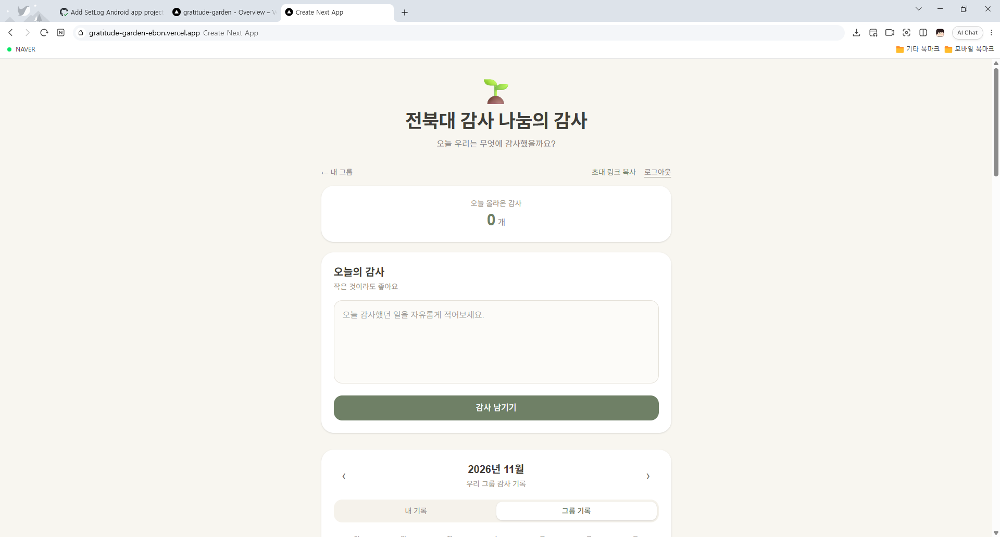
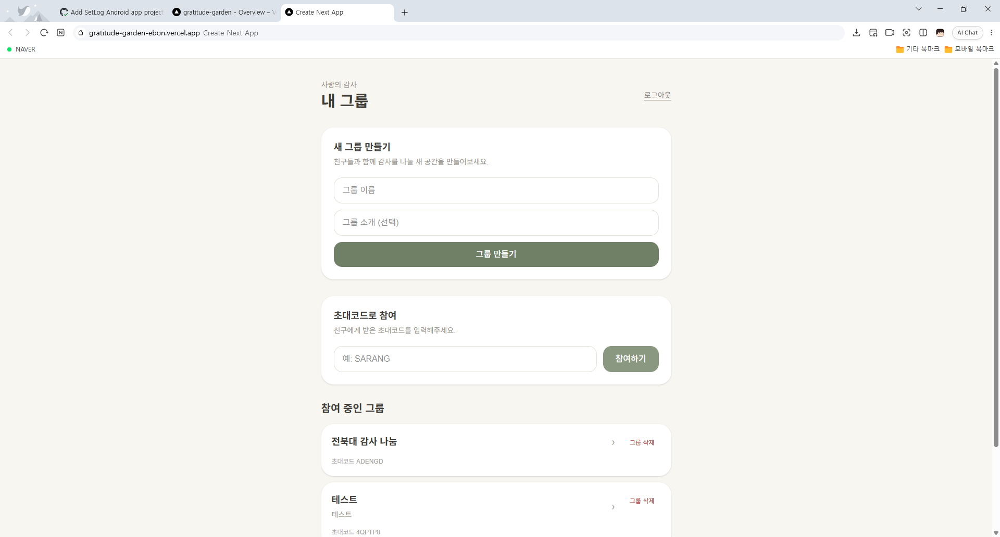

## 프로젝트 소개

일상에서 느낀 감사한 마음을 다른 사람들과 나눌 수 있도록 제작한 웹사이트입니다.

개인뿐만 아니라 그룹 단위로 감사의 내용을 공유할 수 있도록 서비스를 구성했습니다.

## 개발 목적

일상에서 감사했던 일을 기록하고, 이를 다른 사람들과 공유할 수 있는 공간을 만들고자 했습니다.

특히 그룹을 중심으로 서로의 기록을 확인할 수 있는 기능을 구현하는 데 중점을 두었습니다.

## 주요 기능

### 1. 그룹 생성 및 참여

사용자가 직접 그룹을 생성하고 다른 그룹에 참여할 수 있도록 구현했습니다.

### 2. 감사 기록 작성 및 공유

일상에서 감사했던 내용을 작성하고 그룹 구성원들과 공유할 수 있도록 했습니다.

### 3. 사용자 권한 관리

사용자별 데이터 접근 권한을 관리하여 그룹과 관련된 기능을 이용할 수 있도록 했습니다.

### 4. 실시간 데이터 반영

데이터베이스의 변경 사항이 서비스 화면에 반영되도록 구현했습니다.

## 개발 과정에서 경험한 점

개발 과정에서 데이터베이스 접근 권한과 보안 정책으로 인해 그룹 생성 기능이 정상적으로 동작하지 않는 문제가 있었습니다.

문제의 원인을 분석하고 접근 정책을 수정하면서 데이터베이스 권한 관리의 중요성을 배울 수 있었습니다.

## 느낀 점

단순히 화면을 구성하는 것을 넘어 사용자 인증, 데이터 저장, 접근 권한 관리 등 실제 웹서비스에 필요한 요소들을 경험할 수 있었습니다.

앞으로도 사용자가 편리하게 이용할 수 있는 서비스를 개발하고 싶습니다.

### 감사 기록 화면

### 그룹 관리 화면

